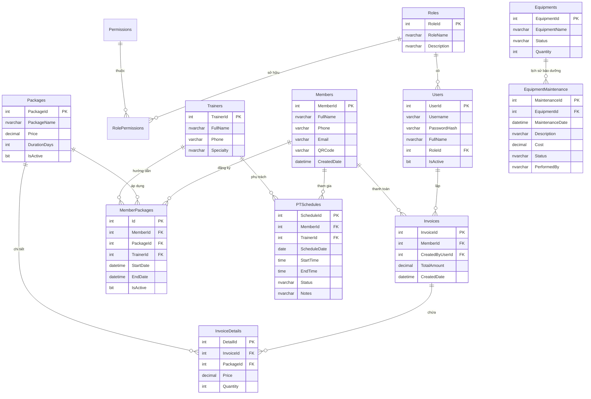

# 🏋️ Hệ Thống Quản Lý Phòng Gym & Fitness (Gym Management System)

[](https://dotnet.microsoft.com/)
[](https://www.nuget.org/packages/EntityFramework/)
[](https://www.microsoft.com/sql-server)
[](https://www.nuget.org/packages/EPPlus/)
[](http://www.aforgenet.com/)
[](https://github.com/micjahn/ZXing.Net)
[](https://jrsoftware.org/isinfo.php)
[](#)

> **Dự án Môn học:** Lập trình trên Windows (LTW)  
> **Đơn vị:** Trường Đại học Sư Phạm TP. Hồ Chí Minh (HCMUE)  
> **Giải pháp phần mềm:** Quản lý toàn diện trung tâm thể hình & Fitness tích hợp Check-in QR Camera thời gian thực, nhắc hạn Email tự động và xuất báo cáo Excel chuyên nghiệp.

---

## 📌 Mục lục
- [1. Giới thiệu tổng quan](#1-giới-thiệu-tổng-quan)
- [2. Tính năng nổi bật & Phân hệ chức năng](#2-tính-năng-nổi-bật--phân-hệ-chức-năng)
- [3. Kiến trúc cơ sở dữ liệu (Database Schema / ERD)](#3-kiến-trúc-cơ-sở-dữ-liệu-database-schema--erd)
- [4. Phân quyền người dùng (RBAC Matrix)](#4-phân-quyền-người-dùng-rbac-matrix)
- [5. Công nghệ & Thư viện sử dụng](#5-công-nghệ--thư-viện-sử-dụng)
- [6. Cấu trúc thư mục dự án](#6-cấu-trúc-thư-mục-dự-án)
- [7. Hướng dẫn cài đặt & Khởi chạy từ A - Z](#7-hướng-dẫn-cài-đặt--khởi-chạy-từ-a---z)
  - [Bước 1: Khởi tạo Cơ sở dữ liệu SQL Server](#bước-1-khởi-tạo-cơ-sở-dữ-liệu-sql-server)
  - [Bước 2: Mở Solution và Restore NuGet](#bước-2-mở-solution-và-restore-nuget)
  - [Bước 3: Cấu hình kết nối Cơ sở dữ liệu](#bước-3-cấu-hình-kết-nối-cơ-sở-dữ-liệu)
  - [Bước 4: Cấu hình gửi Email nhắc hạn (SMTP)](#bước-4-cấu-hình-gửi-email-nhắc-hạn-smtp)
  - [Bước 5: Đóng gói bộ cài đặt Inno Setup (Tùy chọn)](#bước-5-đóng-gói-bộ-cài-đặt-inno-setup-tùy-chọn)
- [8. Danh sách tài khoản thử nghiệm](#8-danh-sách-tài-khoản-thử-nghiệm)
- [9. Phân công nhiệm vụ thành viên](#9-phân-công-nhiệm-vụ-thành-viên)
- [10. Xử lý sự cố thường gặp (Troubleshooting)](#10-xử-lý-sự-cố-thường-gặp-troubleshooting)
- [11. Bản quyền & Đóng góp](#11-bản-quyền--đóng-góp)

---

## 1. Giới thiệu tổng quan

**Gym Management System** là phần mềm quản lý phòng tập thể hình và trung tâm fitness chuyên nghiệp được xây dựng trên nền tảng **Windows Forms (.NET Framework 4.7.2)** kết hợp mô hình ORM **Entity Framework 6 (Database-First)** và hệ quản trị cơ sở dữ liệu **Microsoft SQL Server**.

Hệ thống giải quyết bài toán vận hành hàng ngày của phòng gym từ quy mô vừa đến lớn:
- **Tối ưu hóa quy trình tiếp đón:** Check-in bằng mã QR siêu tốc qua camera/webcam, kiểm tra trạng thái thẻ hội viên ngay lập tức.
- **Tự động hóa chăm sóc khách hàng:** Tác vụ quét nền và gửi email nhắc nhở hội viên khi gói tập sắp hết hạn.
- **Lập lịch tập luyện thông minh:** Đặt lịch hẹn 1-1 với Huấn luyện viên (PT) có cơ chế phát hiện và ngăn ngừa trùng lịch (Conflict Detection).
- **Kiểm soát dòng tiền & Doanh thu:** Quản lý hóa đơn đăng ký, thanh toán, tính tỷ lệ hoa hồng cho HLV và xuất báo cáo tài chính ra file Excel.
- **Bảo mật và an toàn dữ liệu:** Áp dụng mô hình phân quyền chặt chẽ theo chức vụ (**RBAC**) và mã hóa mật khẩu một chiều chuẩn **SHA-256**.

---

## 2. Tính năng nổi bật & Phân hệ chức năng

```
┌────────────────────────────────────────────────────────────────────────┐
│                   HỆ THỐNG QUẢN LÝ PHÒNG GYM & FITNESS                 │
├───────────────┬────────────────┬──────────────────────┬────────────────┤
│ 1. HỆ THỐNG   │ 2. HỘI VIÊN    │ 3. DỊCH VỤ & THU PHÍ │ 4. TIỆN ÍCH    │
├───────────────┼────────────────┼──────────────────────┼────────────────┤
│ • Đăng nhập   │ • Quản lý HV   │ • Danh mục gói tập   │ • Check-in QR  │
│ • Đổi MK      │ • Cấp mã QR    │ • Đăng ký gói tập    │ • Gửi Email    │
│ • Phân quyền  │ • Tìm kiếm live│ • Hóa đơn thanh toán │ • Cấu hình DB  │
│ • Quản lý User│ • Lịch tập PT  │ • Doanh thu & HH PT  │ • Xuất Excel   │
│ • Quản lý Role│ • Xuất Excel   │ • Bảo trì thiết bị   │ • Đóng gói cài │
└───────────────┴────────────────┴──────────────────────┴────────────────┘
```

### 2.1. Phân hệ Hệ thống & Bảo mật (Core & Security)
- **Đăng nhập / Đăng xuất an toàn:** Quản lý phiên làm việc thông qua lớp `UserSession`. Lưu vết thông tin người dùng đang online trên thanh `StatusStrip`.
- **Mã hóa SHA-256:** Bảo vệ mật khẩu trong Database với lớp `SecurityHelper.cs`, cam kết không lưu mật khẩu ở dạng văn bản thuần (plain text).
- **Giao diện MDI đa nhiệm:** Thiết kế MDI Container chuyên nghiệp, tự động định tuyến mở form con, kích hoạt form đang mở thay vì sinh trùng lặp (`OpenChildForm<T>`).
- **Cấu hình kết nối linh hoạt (`Form_ServerConfig`):** Cho phép người dùng chuyển đổi máy chủ SQL Server (Windows Authentication / SQL Server Authentication) trực tiếp trên giao diện mà không cần can thiệp file mã nguồn.

### 2.2. Phân hệ Quản trị & Phân quyền (RBAC Administration)
- **Quản lý Tài khoản người dùng (`Form_UserManagement`):** Thêm mới tài khoản, phân vai trò, đặt lại mật khẩu, khóa/mở khóa tài khoản nhân viên.
- **Quản lý Vai trò (`Form_RoleManagement`):** Định nghĩa vai trò (Admin, Lễ Tân, PT, Hội viên), cấu hình menu và quyền thao tác.

### 2.3. Phân hệ Quản lý Hội viên & Check-in QR (Members & Check-in)
- **Hồ sơ hội viên (`Form_MemberManagement`):** Quản lý họ tên, số điện thoại, email, ngày tham gia; tính năng tìm kiếm tức thì (Live Search theo từ khóa).
- **Cấp mã định danh QR Code:** Tự động sinh mã QR riêng biệt cho từng hội viên để tích hợp thẻ ra vào điện tử.
- **Quét mã Check-in tự động qua Camera (`Form_CheckInQR`):**
  - Tích hợp thư viện **AForge.Video** và **ZXing.Net** để nhận diện mã QR trực tiếp từ Webcam/Camera của máy tính.
  - Tự động tra cứu gói tập của hội viên: Kiểm tra gói đang hoạt động, số ngày còn lại, cảnh báo nếu gói đã hết hạn.
  - Ghi nhận lịch sử check-in vào/ra theo thời gian thực (Real-time).

### 2.4. Phân hệ Gói tập & Huấn luyện viên (Packages & PT Schedules)
- **Danh mục gói tập (`Form_PackageManagement`):** Quản lý tên gói, đơn giá, thời hạn sử dụng (ngày), trạng thái kinh doanh.
- **Đăng ký gói tập (`Form_RegisterPackage`):**
  - Hỗ trợ chọn hội viên, gói tập, chọn Huấn luyện viên cá nhân (PT) phụ trách.
  - Tự động tính ngày bắt đầu và kết thúc gói.
  - Tự động sinh hóa đơn thu tiền ngay tại bước đăng ký với Transaction an toàn.
- **Quản lý Huấn luyện viên (`Form_TrainerManagement`):** Quản lý danh sách HLV, thông tin liên lạc và chuyên môn (Gym, Bodybuilding, Cardio, Boxing, Yoga, Pilates...).
- **Xếp lịch tập với PT (`Form_PTSchedule`):**
  - Đặt lịch hẹn 1-1 giữa Hội viên và Huấn luyện viên theo ngày và khung giờ (`StartTime` - `EndTime`).
  - **Thuật toán kiểm tra trùng lịch (Conflict Detection):** Cảnh báo ngay lập tức nếu HLV hoặc Hội viên đã có lịch tập khác trong cùng khung giờ.
  - Cập nhật trạng thái buổi tập: *Đã lên lịch*, *Đã hoàn thành*, *Hội viên vắng mặt*, *Đã hủy*.

### 2.5. Phân hệ Thu ngân, Hóa đơn & Báo cáo doanh thu (Billing & Analytics)
- **Quản lý Hóa đơn (`Form_InvoiceList`):** Tra cứu toàn bộ hóa đơn thanh toán, xem chi tiết gói dịch vụ, nhân viên lập đơn, ngày giờ lập hóa đơn.
- **Báo cáo Thống kê Doanh thu (`Form_RevenueReport`):**
  - Thống kê doanh thu theo mốc thời gian (hôm nay, theo tháng, theo năm, hoặc tùy chỉnh từ ngày đến ngày).
  - Thống kê top các gói tập bán chạy nhất phòng gym.
  - Tự động tính toán hoa hồng (Commission) cho Huấn luyện viên PT dựa trên các gói tập có đăng ký PT đi kèm.

### 2.6. Phân hệ Cơ sở vật chất & Bảo trì thiết bị (Equipment & Maintenance)
- **Quản lý thiết bị (`Form_EquipmentManagement`):** Danh mục máy chạy bộ, tạ tay, máy kéo cáp, giàn tạ đa năng; theo dõi số lượng và tình trạng hoạt động (Tốt, Cần bảo trì, Hỏng).
- **Lịch sử sửa chữa & Chi phí bảo trì (`EquipmentMaintenance`):** Ghi chép nhật ký bảo trì máy, chi phí phát sinh, ngày sửa và kỹ thuật viên phụ trách nhằm tối ưu chi phí vận hành.

### 2.7. Phân hệ Tự động hóa & Tiện ích mở rộng (Automation & Utilities)
- **Cảnh báo nền & Gửi Email nhắc hạn (`EmailReminderService` & `Form_EmailReminder`):**
  - Form chính (`Form_Main`) tự động chạy tác vụ ngầm kiểm tra các hội viên có gói tập sắp hết hạn trong vòng 5 ngày và hiển thị cảnh báo nhấp nháy trên thanh trạng thái.
  - Giao diện gửi email nhắc nhở hỗ trợ cấu hình SMTP (Gmail), gửi thông báo đơn lẻ hoặc gửi hàng loạt (Bulk Email) với template HTML được thiết kế đẹp mắt.
- **Xuất báo cáo Excel chuyên nghiệp (`ExcelExportHelper`):**
  - Sử dụng thư viện **EPPlus** tạo file `.xlsx` định dạng chuẩn: header in đậm màu thương hiệu, tự động căn chỉnh độ rộng cột (Auto-fit Columns), viền bảng (Borders) và thông tin thời gian xuất.
  - Hỗ trợ xuất dữ liệu Hội viên, Hóa đơn, Doanh thu, Thiết bị, Lịch tập mà **không yêu cầu máy tính cài đặt Microsoft Office**.
- **Đóng gói bộ cài đặt Inno Setup (`GymManagement_Setup.iss`):**
  - Tạo file cài đặt `GymManagement_Setup_v1.0.exe` độc lập, tự động tạo shortcut ngoài màn hình Desktop và tích hợp kèm file script cơ sở dữ liệu.

---

## 3. Kiến trúc cơ sở dữ liệu (Database Schema / ERD)

Cơ sở dữ liệu **GymManagementDB** gồm 13 bảng được chuẩn hóa, đảm bảo tính toàn vẹn dữ liệu:



---

## 4. Phân quyền người dùng (RBAC Matrix)

Hệ thống kiểm soát truy cập nghiêm ngặt dựa trên vai trò của tài khoản sau khi đăng nhập:

| Chức năng / Phân hệ | Quản trị viên (Admin) | Lễ Tân (Receptionist) | Huấn luyện viên (PT) | Hội viên (Member) |
| :--- | :---: | :---: | :---: | :---: |
| **Quản trị Tài khoản & Phân quyền** |  Toàn quyền |  Bị khóa |  Bị khóa |  Bị khóa |
| **Cấu hình Kết nối CSDL (Server Config)** |  Toàn quyền |  Bị ẩn |  Bị ẩn |  Bị ẩn |
| **Quản lý Danh sách Hội viên** |  Toàn quyền |  Thêm/Sửa/Tìm kiếm |  Chỉ xem HV phụ trách |  Bị khóa |
| **Quét mã QR Check-in Camera** |  Toàn quyền |  Cho phép |  Cho phép |  Bị khóa |
| **Quản lý Danh mục Gói tập** |  Toàn quyền |  Chỉ xem |  Chỉ xem |  Chỉ xem |
| **Đăng ký Gói tập & Lập Hóa đơn** |  Toàn quyền |  Toàn quyền |  Bị khóa |  Bị khóa |
| **Quản lý Lịch tập Huấn luyện viên (PT)** |  Toàn quyền |  Đặt lịch cho HV |  Xem & Đổi trạng thái |  Bị khóa |
| **Xem Danh sách Hóa đơn** |  Toàn quyền |  Xem hóa đơn đã lập |  Bị khóa |  Bị khóa |
| **Báo cáo Thống kê & Doanh thu** |  Toàn quyền |  Bị khóa |  Bị khóa |  Bị khóa |
| **Quản lý Thiết bị & Lịch bảo trì** |  Toàn quyền |  Xem & Báo hỏng |  Xem thiết bị |  Bị khóa |
| **Gửi Email nhắc hạn gói tập** |  Toàn quyền |  Cho phép |  Bị khóa |  Bị khóa |
| **Xuất báo cáo Excel** |  Toàn quyền |  Hội viên & Hóa đơn |  Lịch dạy cá nhân |  Bị khóa |

---

## 5. Công nghệ & Thư viện sử dụng

| Công nghệ / Thư viện | Phiên bản | Mục đích sử dụng |
| :--- | :---: | :--- |
| **C# / .NET Framework** | `4.7.2` | Nền tảng phát triển ứng dụng chính trên hệ điều hành Windows |
| **Windows Forms (WinForms)** | - | Xây dựng giao diện người dùng theo kiến trúc MDI Application |
| **Microsoft SQL Server** | `2019+` | Hệ quản trị cơ sở dữ liệu quan hệ lưu trữ thông tin hệ thống |
| **Entity Framework 6** | `6.5.2` | ORM truy vấn cơ sở dữ liệu theo mô hình Database-First qua EDMX |
| **ZXing.Net** | `0.16.9` | Thư viện giải mã và sinh mã vạch / QR Code chất lượng cao |
| **AForge.NET & DirectShow** | `2.2.5` | Điều khiển Webcam/Camera máy tính để stream video và quét QR trực tiếp |
| **EPPlus** | `4.5.3.3` | Tạo và xuất các báo cáo bảng tính Excel (.xlsx) độc lập |
| **System.Net.Mail (SMTP)** | - | Dịch vụ gửi email thông báo qua máy chủ Google Gmail |
| **Inno Setup** | `6.x` | Trình biên dịch đóng gói sản phẩm thành bộ cài đặt `Setup.exe` |

---

## 6. Cấu trúc thư mục dự án

```text
GymManagementSystem/
│
├── GymManagementDB.sql            # Script khởi tạo Database, bảng và dữ liệu mẫu đầy đủ
├── GymManagementSystem.sln        # Solution chính mở bằng Visual Studio
├── GymManagement_Setup.iss        # Kịch bản biên dịch bộ cài đặt Inno Setup
├── README.md                      # Tài liệu hướng dẫn chi tiết dự án
│
├── packages/                      # Thư viện NuGet phụ thuộc (AForge, ZXing, EPPlus, EF6)
│
└── LTWCHARLIEKODE/                # Project Windows Forms C#
    ├── App.config                 # Cấu hình chuỗi kết nối và tham số Entity Framework
    ├── packages.config            # Danh sách gói NuGet quản lý bởi dự án
    ├── Program.cs                 # Điểm khởi chạy ứng dụng (Main Entry Point)
    │
    ├── GymModel.edmx              # Sơ đồ ánh xạ Entity Data Model (EDMX)
    ├── GymModel.Context.cs        # DbContext đại diện cho CSDL GymManagementDB
    │
    ├── SecurityHelper.cs          # Tiện ích băm mã hóa mật khẩu SHA-256 an toàn
    ├── UserSession.cs             # Quản lý trạng thái và phiên đăng nhập của người dùng
    ├── ExcelExportHelper.cs       # Module tiện ích xuất DataTable ra Excel bằng EPPlus
    ├── EmailReminderService.cs    # Dịch vụ quét hội viên hết hạn & gửi Email qua SMTP
    │
    ├── Form_Login.cs              # Giao diện Đăng nhập hệ thống
    ├── Form_Main.cs               # Giao diện chính MDI điều hướng và phân quyền
    ├── Form_ChangePassword.cs     # Giao diện Đổi mật khẩu tài khoản
    ├── Form_ServerConfig.cs       # Giao diện Cấu hình kết nối SQL Server linh hoạt
    │
    ├── Form_UserManagement.cs     # Giao diện Quản lý Tài khoản người dùng (Admin)
    ├── Form_RoleManagement.cs     # Giao diện Quản lý Phân quyền vai trò
    │
    ├── Form_MemberManagement.cs   # Giao diện Quản lý Hội viên & Cấp mã QR
    ├── Form_CheckInQR.cs          # Giao diện Quét QR Check-in tự động bằng Camera
    ├── Form_PackageManagement.cs  # Giao diện Quản lý Danh mục Gói tập
    ├── Form_RegisterPackage.cs    # Giao diện Đăng ký gói tập cho Hội viên
    │
    ├── Form_TrainerManagement.cs  # Giao diện Quản lý Huấn luyện viên (PT)
    ├── Form_PTSchedule.cs         # Giao diện Quản lý Lịch tập cá nhân với PT
    │
    ├── Form_InvoiceList.cs        # Giao diện Danh sách và Chi tiết Hóa đơn thu phí
    ├── Form_RevenueReport.cs      # Giao diện Báo cáo Doanh thu & Tính hoa hồng PT
    ├── Form_EquipmentManagement.cs# Giao diện Quản lý Thiết bị & Lịch bảo dưỡng
    └── Form_EmailReminder.cs      # Giao diện Gửi Email cảnh báo hết hạn gói tập
```

---

## 7. Hướng dẫn cài đặt & Khởi chạy từ A - Z

### Bước 1: Khởi tạo Cơ sở dữ liệu SQL Server
1. Mở công cụ **SQL Server Management Studio (SSMS)**.
2. Kết nối tới instance SQL Server của bạn (ví dụ: `.\SQLEXPRESS` hoặc `(local)` hoặc `localhost`).
3. Mở tệp `GymManagementDB.sql` nằm ở thư mục gốc của dự án.
4. Nhấn phím **F5** (hoặc nút **Execute**) để khởi tạo database `GymManagementDB` cùng toàn bộ 13 bảng và dữ liệu mẫu đầy đủ.

### Bước 2: Mở Solution và Restore NuGet
1. Khởi động **Visual Studio 2019** hoặc **Visual Studio 2022**.
2. Mở file `GymManagementSystem.sln`.
3. Nhấp chuột phải vào Solution trên cửa sổ *Solution Explorer* -> chọn **Restore NuGet Packages** để tự động tải về các thư viện:
   - `EntityFramework`
   - `EPPlus`
   - `ZXing.Net`
   - `AForge`, `AForge.Video`, `AForge.Video.DirectShow`

### Bước 3: Cấu hình kết nối Cơ sở dữ liệu
Bạn có thể áp dụng 1 trong 2 cách sau:

#### Cách 1: Thay đổi trực tiếp trong file `App.config`
Mở file `LTWCHARLIEKODE/App.config`, tại thẻ `<connectionStrings>`, cập nhật tham số `data source` tương ứng với tên SQL Server của máy bạn:

```xml
<connectionStrings>
  <add name="GymManagementDBEntities1" 
       connectionString="metadata=res://*/GymModel.csdl|res://*/GymModel.ssdl|res://*/GymModel.msl;provider=System.Data.SqlClient;provider connection string=&quot;data source=.\SQLEXPRESS;initial catalog=GymManagementDB;integrated security=True;encrypt=False;trustservercertificate=True;MultipleActiveResultSets=True;App=EntityFramework&quot;" 
       providerName="System.Data.EntityClient" />
</connectionStrings>
```

#### Cách 2: Sử dụng giao diện Cấu hình Máy chủ (`Form_ServerConfig`)
- Đăng nhập vào phần mềm với tài khoản **Admin**.
- Vào menu **Hệ thống** -> chọn **Cấu hình máy chủ**.
- Nhập Tên máy chủ (Server Name), chọn phương thức xác thực (Windows Auth hoặc SQL Server Auth), bấm **Kiểm tra kết nối** và **Lưu cấu hình**. Phần mềm sẽ tự động cập nhật chuỗi kết nối cho bạn.

### Bước 4: Cấu hình gửi Email nhắc hạn (SMTP)
Để kích hoạt tính năng gửi email tự động qua Gmail:
1. Mở phân hệ **Tiện ích** -> **Gửi Email Nhắc Hạn** (hoặc bấm vào cảnh báo trên StatusStrip).
2. Chuyển sang tab **Cấu hình SMTP**:
   - **SMTP Host:** `smtp.gmail.com`
   - **Port:** `587`
   - **Bật SSL:** `Đã chọn`
   - **Email người gửi:** Nhập tài khoản Gmail của phòng gym.
   - **Mật khẩu ứng dụng (App Password):** Nhập mật khẩu ứng dụng 16 ký tự do Google cấp (xem hướng dẫn tạo tại [Google App Passwords](https://myaccount.google.com/apppasswords)).
3. Bấm **Lưu Cấu Hình**.

### Bước 5: Đóng gói bộ cài đặt Inno Setup (Tùy chọn)
1. Build dự án ở chế độ **Release** trong Visual Studio.
2. Tải và cài đặt phần mềm [Inno Setup](https://jrsoftware.org/isdl.php).
3. Mở file `GymManagement_Setup.iss` bằng Inno Setup Compiler.
4. Nhấn phím **F9** (hoặc nút **Build/Compile**).
5. Bộ cài đặt hoàn chỉnh `GymManagement_Setup_v1.0.exe` sẽ được xuất ra trong thư mục `SetupOutput/`.

---

## 8. Danh sách tài khoản thử nghiệm

Sau khi thực thi script SQL, hệ thống đã chuẩn bị sẵn các tài khoản tương ứng với từng vai trò phục vụ kiểm thử và chấm điểm:

| Tên đăng nhập | Mật khẩu mặc định | Họ và tên | Vai trò | Mô tả quyền hạn |
| :--- | :---: | :--- | :---: | :--- |
| `admin` | `123456` | Quản Trị Viên | **Admin** | Toàn quyền kiểm soát toàn bộ hệ thống |
| `tuan` | `123456` | Hứa Nhựt Tuấn | **Admin** | Tài khoản quản trị viên chính |
| `tuanhua` | `123456` | Hứa Nhựt Tuấn | **Admin** | Tài khoản quản trị viên dự phòng |
| `letan` | `123456` | Nguyễn Văn Lễ Tân | **Lễ Tân** | Tiếp đón hội viên, check-in, bán gói, xuất hóa đơn |
| `pt_tuan` | `123456` | Hứa Nhựt Tuấn (PT) | **PT** | Xem lịch dạy, quản lý hội viên phụ trách, tra cứu thiết bị |

> 💡 **Lưu ý bảo mật:** Toàn bộ mật khẩu mặc định `123456` được băm bằng thuật toán SHA-256 (`8d969eef6ecad3c29a3a629280e686cf0c3f5d5a86aff3ca12020c923adc6c92`). Bạn có thể đổi mật khẩu bất cứ lúc nào tại mục **Hệ thống** -> **Đổi mật khẩu**.

---

## 9. Phân công nhiệm vụ thành viên

Dự án được phân chia theo từng module nghiệp vụ rõ ràng, cam kết cân bằng khối lượng công việc và hỗ trợ tối đa quá trình làm việc nhóm:

```
┌────────────────────────────────────────────────────────────────────────────────┐
│                          PHÂN CÔNG CÔNG VIỆC NHÓM                              │
├────────────────────┬───────────────────────────────────────────────────────────┤
│ THÀNH VIÊN         │ PHẠM VI TRÁCH NHIỆM & CÁC TỆP LIÊN QUAN                   │
├────────────────────┼───────────────────────────────────────────────────────────┤
│ 👑 Hứa Nhựt Tuấn   │ • Kiến trúc tổng thể, thiết kế CSDL (GymManagementDB.sql) │
│    (Trưởng nhóm)   │ • Module Hệ thống: Form_Login, Form_Main (MDI), UserSession│
│                    │ • Bảo mật: SecurityHelper (SHA-256), Đổi mật khẩu         │
│                    │ • Phân quyền RBAC, Form_UserManagement, Form_RoleManagement│
│                    │ • Tiện ích xuất Excel dùng chung (ExcelExportHelper)      │
├────────────────────┼───────────────────────────────────────────────────────────┤
│ 👤 Lê Văn Gia Bảo  │ • Phân hệ Đăng ký Gói tập: Form_RegisterPackage           │
│    (Thành viên 1)  │ • Quản lý Hóa đơn & Chi tiết thanh toán: Form_InvoiceList  │
│                    │ • Quản lý Lịch tập PT & Thuật toán kiểm tra trùng lịch:   │
│                    │   Form_PTSchedule (Conflict Detection)                    │
│                    │ • Báo cáo Doanh thu & Tính hoa hồng cho PT:               │
│                    │   Form_RevenueReport                                      │
├────────────────────┼───────────────────────────────────────────────────────────┤
│ 👤 Nguyễn Đăng Khoa│ • Tích hợp Check-in QR Camera thời gian thực:             │
│    (Thành viên 2)  │   Form_CheckInQR (AForge.NET + ZXing.Net)                 │
│                    │ • Phân hệ Email nhắc hạn & Dịch vụ quét ngầm:             │
│                    │   EmailReminderService, Form_EmailReminder                │
│                    │ • Giao diện Cấu hình chuỗi kết nối Server:                │
│                    │   Form_ServerConfig                                       │
│                    │ • Quản lý Thiết bị & Chi phí sửa chữa:                    │
│                    │   Form_EquipmentManagement                                │
│                    │ • Kịch bản đóng gói bộ cài đặt: GymManagement_Setup.iss   │
├────────────────────┼───────────────────────────────────────────────────────────┤
│ 👤 Huỳnh Phú Vinh  │ • Phân hệ Quản lý Hội viên: Form_MemberManagement         │
│    (Thành viên 3)  │ • Cơ chế tìm kiếm tức thì (Live Search hội viên)          │
│                    │ • Sinh và gán mã định danh QR Code cho hội viên           │
│                    │ • Phân hệ Danh mục Gói tập: Form_PackageManagement        │
└────────────────────┴───────────────────────────────────────────────────────────┘
```

---

## 10. Xử lý sự cố thường gặp (Troubleshooting)

### 1. Lỗi kết nối Cơ sở dữ liệu: `The server was not found or was not accessible`
- **Nguyên nhân:** Tên instance SQL Server trong chuỗi kết nối chưa khớp với máy của bạn hoặc dịch vụ SQL Server chưa được khởi động.
- **Giải pháp:**
  - Mở `services.msc`, tìm dịch vụ **SQL Server (SQLEXPRESS)** hoặc **SQL Server (MSSQLSERVER)** và chọn **Start**.
  - Kiểm tra tên server trong SSMS (thường là `.\SQLEXPRESS`, `(local)`, hoặc `localhost`) và cập nhật vào `Form_ServerConfig` hoặc `App.config`.

### 2. Lỗi Camera không nhận diện: `Không tìm thấy Webcam`
- **Nguyên nhân:** Máy tính chưa cấp quyền truy cập Camera cho ứng dụng hoặc chưa cắm Webcam.
- **Giải pháp:**
  - Đảm bảo webcam hoạt động bình thường trên ứng dụng Camera mặc định của Windows.
  - Kiểm tra `Settings -> Privacy & Security -> Camera` và bật tính năng cho phép ứng dụng truy cập camera.

### 3. Lỗi gửi Email SMTP: `The SMTP server requires a secure connection or the client was not authenticated`
- **Nguyên nhân:** Sử dụng mật khẩu tài khoản Gmail thông thường thay vì **Mật khẩu ứng dụng (App Password)**, hoặc chưa bật bảo mật 2 lớp (2FA).
- **Giải pháp:**
  - Bật xác minh 2 bước cho tài khoản Google của bạn.
  - Truy cập [Google App Passwords](https://myaccount.google.com/apppasswords), tạo một mật khẩu ứng dụng mới (16 ký tự).
  - Dán mật khẩu 16 ký tự này vào ô Mật khẩu trong tab Cấu hình SMTP của phần mềm.

### 4. Lỗi xuất file Excel: `The process cannot access the file because it is being used by another process`
- **Nguyên nhân:** File Excel có cùng tên đang được mở bằng ứng dụng Microsoft Excel trên máy tính.
- **Giải pháp:** Đóng file Excel đang mở trước khi thực hiện thao tác xuất file mới.

---

## 11. Bản quyền & Đóng góp

- **Môn học:** Lập trình trên Windows (LTW)
- **Học kỳ:** Năm học 2026 - 2027
- **Bản quyền:** Sản phẩm thuộc quyền sở hữu học thuật của Nhóm 4 - HCMUE.
- Mọi đóng góp, báo lỗi hoặc yêu cầu cải tiến vui lòng tạo **Issue** hoặc gửi **Pull Request** về kho lưu trữ GitHub của dự án.
